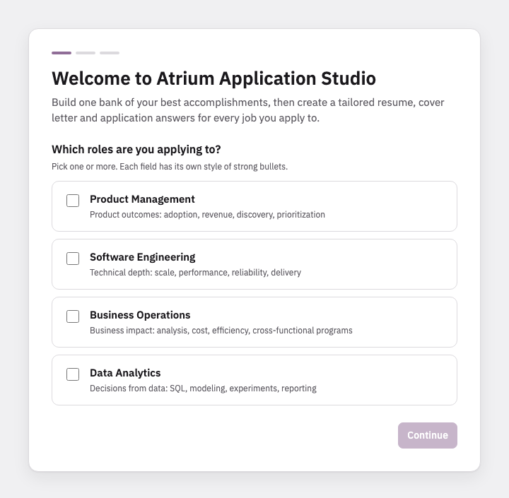
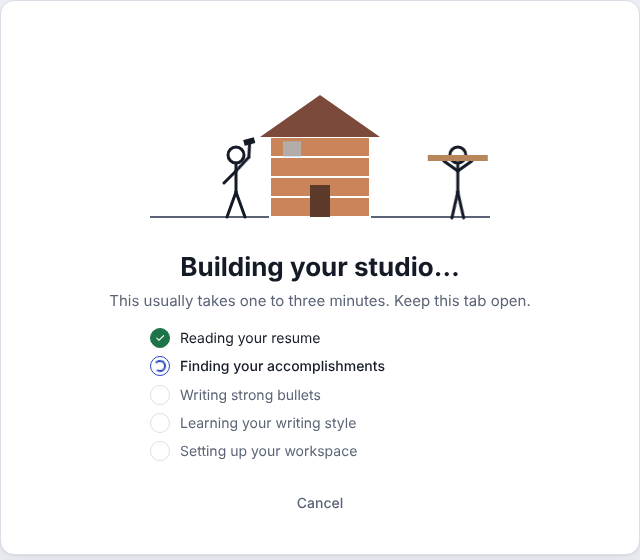
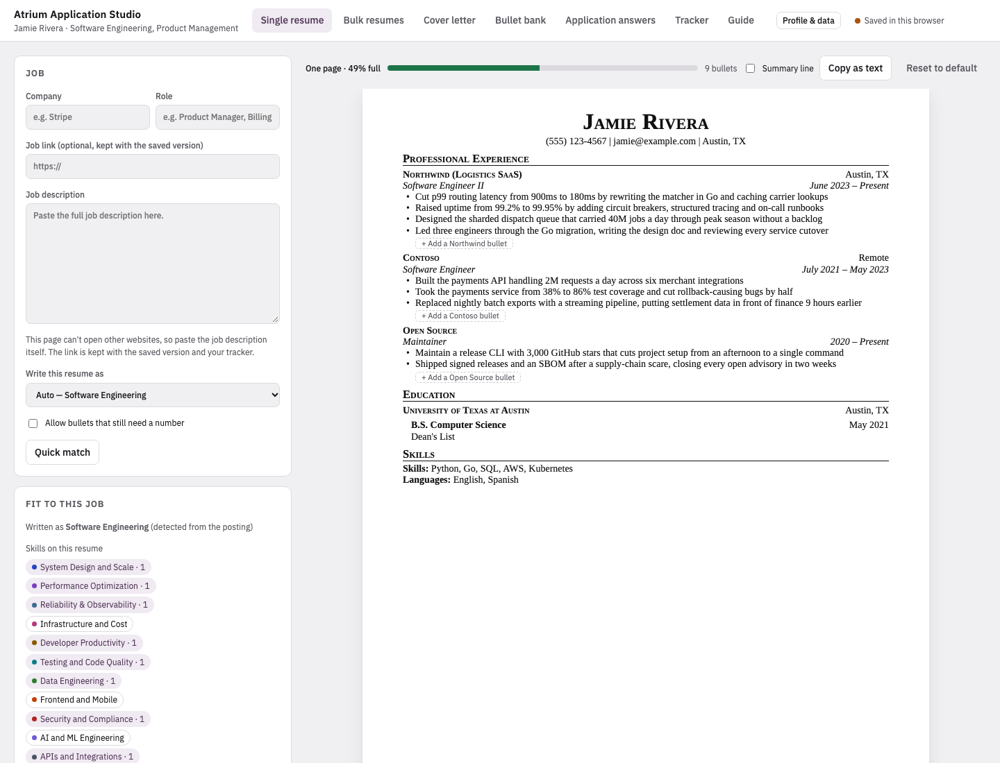
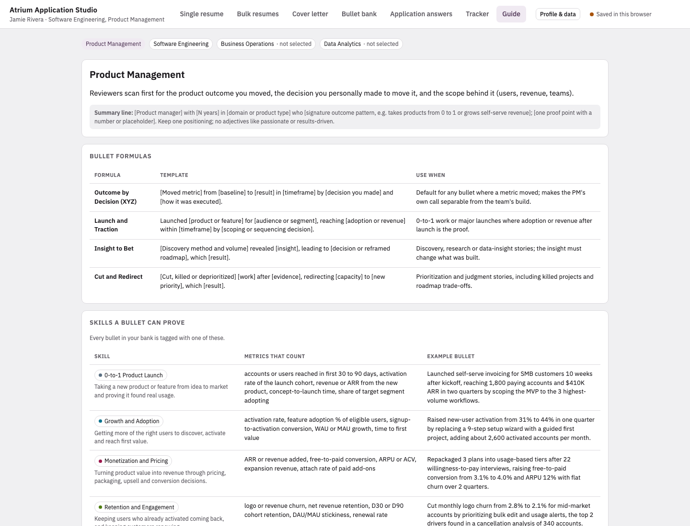

# Atrium Application Studio

Tailor a resume, cover letter and application answers to every job from one bank of your best accomplishments.

Job seekers rewrite the same resume dozens of times, and the bullets usually get weaker each time. Atrium Application Studio flips that: you build one bank of strong, verified bullets once, and every application pulls the best ones for that job. The AI picks and lightly rewords, but it never invents a fact or a number.

## How it works

1. **Onboarding.** Pick the roles you're applying to (Product Management, Software Engineering, Business Operations, Data Analytics). Upload your resume and a list of accomplishments, plus optional writing samples.
2. **Claude builds your studio** while two Romans carry benches, statues, vases and plants into an atrium. It parses your resume, rewrites your accomplishments into strong bullets in the style of each field, tags each bullet with the one skill it proves, and learns your writing voice from your samples.
3. **Apply.** Paste a job description and get a one-page resume, a cover letter and application answers tailored to it.

## Features

- **Tailor resume.** Claude matches the job description to your bank and picks the strongest bullet for each role. Swap, reorder or remove bullets in a live one-page preview with a page-fit meter, then export a PDF. A local skill-and-keyword match works without AI.
- **Bulk resumes.** Tailor resumes (and optionally cover letters) for five or more jobs at once and download them as a zip.
- **Cover letters** written in your own voice, learned from letters you upload.
- **Application answers** for common questions (why this company, why you, field-specific prompts), drafted from your real stories.
- **Bullet bank.** Every bullet proves one skill. `[Bracketed placeholders]` mark numbers still to collect. "Add new experience" turns rough notes or an updated resume into new bullets, skipping duplicates.
- **Tracker.** Every resume you make is logged as Applied. Move it through Interview scheduled, Interview done, Case, Offer or Rejected. Days since applied turns green, yellow or red based on how long since the last update.
- **Guide.** A field-by-field playbook of what strong resumes look like.

## Field-specific resume guides

Different fields reward different evidence, so each field gets its own guide (`research/field-guides.json`):

| Field | What a strong bullet leads with |
| --- | --- |
| Product Management | The product outcome moved (adoption, activation, revenue, churn) and the decision the PM made to move it |
| Software Engineering | Before-and-after numbers on latency, throughput, reliability, cost or delivery speed, at real scale |
| Business Operations | A mini case: analysis, recommendation, result in dollars or time saved |
| Data Analytics | The decision the analysis changed, the data behind it, and the tools used |

Each guide has bullet formulas, 12 skills with the metrics that count for each, weak-to-strong rewrites, seniority signals and common application questions. The guides came from research into published hiring guidance and successful resumes (`research/notes.md`), then a separate resume-expert review pass that corrected outdated metrics and removed weak patterns. The guides drive every prompt in the app.

## Design decisions

- **No invented facts.** The AI can only choose bullets that exist in your bank and use numbers exactly as you gave them. A missing number becomes a `[placeholder]`, with a fallback version of the bullet that still reads well without it.
- **One skill per bullet.** Tagging forces each bullet to prove something specific, and shows where the bank is thin.
- **Works without AI.** Quick match, PDF export, the tracker and manual editing all work offline.
- **Your data stays yours.** Work saves to your own Claude account or your browser, with a JSON backup and restore.

## Tech

- Plain HTML, CSS and JavaScript in a single file (`index.html`), with no build step
- [jsPDF](https://github.com/parallax/jsPDF) for PDF export, [JSZip](https://stuk.github.io/jszip/) for bulk downloads, and [mammoth.js](https://github.com/mwilliamson/mammoth.js) and [PDF.js](https://mozilla.github.io/pdf.js/) for reading uploaded files, all loaded from cdnjs
- Runs as a Claude artifact. Claude calls, per-user storage and downloads use the artifact runtime (`window.claude`), so each person runs on their own Claude plan. Opened as a plain file, the page falls back to quick match and browser storage.

## Run locally

Open `index.html` in a browser. Screenshots show a fictional example profile.
